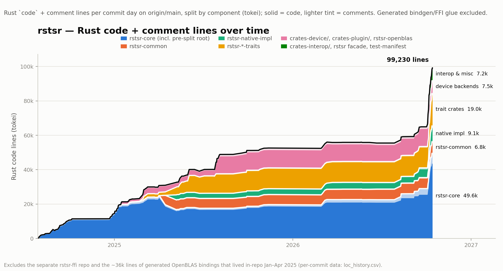

## RSTSR 3rd Report: A Rust n-Dimensional Tensor Scientific Computing Library in the AI Era -- Progress, Changes, and the Future

Two years have passed since RSTSR's first commit in July 2024.

We have now finally reached a milestone: an efficient, native-Rust n-dimensional tensor scientific computing library for CPU that is **highly compatible with the NumPy interface**.

We now consider the initial goal of a CPU-side Rust n-dimensional tensor scientific computing library to be achieved, with respect to the basic needs of atomic-orbital-based electronic structure programs. (Note that although RSTSR has a broad goal, it still serves as a subproject of an electronic structure program.)

<!-- truncate -->

## 1. RSTSR v0.10 Progress: Full Compatibility with the Python Array API 2025

### 1.1 Compatible with the Python Array API

As a native Rust library, RSTSR implements almost all interfaces of the [Python Array API](https://data-apis.org/array-api/latest) 2025 standard. RSTSR is no longer merely "inspired by the Array API"; it is a non-Python library that genuinely implements the Array API standard.

- **Evidence**: The simple Python wrapper [rstsr-faer-py](https://pypi.org/project/rstsr-faer-py), built on RSTSR v0.10.0 and the Faer backend, is available on PyPI; against the [Array API 2025 test suite](https://github.com/data-apis/array-api-tests) the result is 1336 Pass / 17 Fail / 33 Skip (compared with NumPy 2.5's 1339 Pass / 42 Fail / 5 Skip). Of these, 14 Fail / 33 Skip are attributable to the test suite itself and to the RSTSR Faer backend not implementing FFT; the remaining 3 Fail are SVD overflow issues with excessively large floating-point values, rare in practical use. This shows that, apart from FFT, RSTSR correctly implements all interfaces of the Array API 2025.

- **Almost**: All the important interfaces are implemented; only a small number are difficult or impossible to implement, due to characteristics of the Rust language itself. These excluded features include:
  - Operator overloads such as `__ipow__` and `__imatmul__`, which Python permits but Rust does not have (they can, however, be realized as functions);
  - Dynamically typed lists, which Python permits but which Rust finds very difficult to realize with static types; the affected functions include `concat` and `stack` (though as long as the tensors have the same type, RSTSR can still use `rt::concat` and `rt::stack`).

### 1.2 More Readable Code

> Here we put forward a possibly unorthodox view: Rust can be written very concisely, and is a language suitable for developing scientific computing programs.
>
> RSTSR's own code may not be simple, especially given the large number of complex trait bounds. But RSTSR's user interface is very concise.

Implementing all of the Python Array API standard means we support many advanced NumPy features that linear algebra libraries usually lack, but that greatly ease program writing.

NumPy is often praised for being convenient and easy to use. We point out that **features NumPy can accomplish in one line of code or one declaration, RSTSR can usually also accomplish in one line of code or one declaration**. We do not intend to detail all of RSTSR's features here; users familiar with NumPy can consult the [RSTSR ↔ NumPy cheat sheet](https://docs.rs/rstsr/latest/rstsr/cheatsheet/index.html). Here we highlight a few features commonly used by electronic structure programs.

For electronic structure programs, the most critical advanced features of a high-dimensional tensor library are basic indexing, tensor shape reshaping (reshape), and broadcasting.

Basic indexing extracts a sub-matrix/sub-tensor but **does not copy data**; a matrix produced by sensible basic indexing can be passed directly into BLAS/LAPACK computations without additional memory overhead. Basic indexing is typically used to cut small matrices out of a large tensor, for computation or assignment.

| NumPy | RSTSR | Description |
|--|--|--|
| `a[2]` | `a.i(2)` | Index a single axis |
| `a[:, 3]` | `a.i((.., 3))` | Index the second axis |
| `a[2:6]` | `a.i(2..6)` | Slice a single axis |
| `a[0:2, 2:4]` | `a.i((0..2, 2..4))` | Slice multiple axes |
| `a[..., -1]` | `a.i((Ellipsis, -1))` | Index the last axis |
| `a[:, None]` | `a.i((.., None))` | Add a new axis |
| `a[2:10:2]` | `a.i(slice!(2, 10, 2))` | Strided slice |
| `a[::-1]` | `a.i(slice!(None, None, -1))` | Reverse slice |
| `a[:, 3] = b` | `a.i_mut((.., 3)).assign(&b)` | Write to a mutable view |

The reshape function is often used to convert dense high-dimensional tensor operations into matrix problems at zero cost, or, when reading in contiguous in-memory data, to re-lay it out as a high-dimensional tensor.

| NumPy | RSTSR | Description |
|--|--|--|
| `a.reshape(3, 4)` | `a.reshape((3, 4))` | Returns a `TensorCow` (owned or viewed data) |
| `a.reshape(3, 4).copy()` | `a.into_shape((3, 4))` | Returns a `Tensor` (owned data) |
| `a.reshape(-1)` | `a.reshape(-1)` | Flatten data to 1-D |
| `a.reshape((3, 4), order="F")` | `a.to_layout([3, 4].f())` | Re-lay-out data in Fortran-contiguous order |

Electronic structure programs occasionally use advanced indexing (advanced/fancy/array indexing). Advanced indexing can be used for frozen-orbital handling in post-SCF methods, occupied-orbital selection, or random sampling of certain tensor dimensions during computation.

| NumPy | RSTSR | Description |
|--|--|--|
| `a[[0, 2, 4]]` | `a.array_index([0, 2, 4])` | Take data along the first axis by a list |
| `a[[0, 2, 4], [0, 1, 2]]` | `a.array_index(([0, 2, 4], [0, 1, 2]))` | Take data along the first and second axes |
| `a[[0, 2, 4], 1]` | `a.array_index(([0, 2, 4], 1))` | Mix basic and advanced indexing |
| `a[:, [1, 8, 7]]` | `a.array_index((.., [1, 8, 7]))` | Mix basic and advanced indexing |

### 1.3 Important Feature Improvements Over the Past Year

- **Better zero-overhead reshape support.** A zero-overhead reshape generally requires the input tensor to be sufficiently contiguous in memory; previously reshape required a strictly c/f-contiguous memory layout, whereas now reshape can proceed under looser conditions.
- **Better column-major support.** RSTSR is row-major by default, but in the electronic structure program REST it is used in practice with a column-major memory layout. For this reason we adopted broadcast and reshape rules different from those of row-major, to better support tensor operations on column-major memory layouts. See [Row/column-major order semantics](https://docs.rs/rstsr/latest/rstsr/order_semantics/index.html) for details.
- **Einstein summation support.** With the external TBLIS tensor-contraction library, RSTSR can perform tensor contractions using the same Einstein summation syntax as NumPy. See [`rt::tblis::einsum`](https://docs.rs/rstsr/latest/rstsr/prelude/rstsr_funcs/tblis/fn.einsum.html) for details.
- **Efficient Vecdot support.** In electronic structure, especially in some dense DFT matrix computations, `"pi, pi -> p"`-type tensor contractions are very common, and are indeed a non-trivial memory-bandwidth bottleneck. Our implementation of [`rt::vecdot`](https://docs.rs/rstsr/latest/rstsr/prelude/rstsr_funcs/fn.vecdot.html) is not naive; it performs excellently under multi-core parallelism, being much faster than a plain elementwise multiply followed by a sum, and with lower memory overhead.

These are features that the Array API standard does not have or require, but that are important or potentially valuable for developing the REST electronic structure program. For the parts required by the Array API standard, we have also made many implementations and improvements, especially the wrapping and implementation of numerous linear algebra functions (SVD, QR, pseudo-inverse, etc.).

### 1.4 Restating Existing Features

Here we reintroduce some features that have existed since early versions. They are likewise important pillars of RSTSR and are what distinguish it from other Python or Rust high-dimensional tensor libraries, but they have not seen important updates in the recent progress.

- **Excellent parallelism management**: For multi-threaded BLAS backends, by controlling rayon threads we guarantee that whether RSTSR's general computations or matrix linear algebra are called inside or outside rayon parallel threads, they fully exploit the parallel hardware, and do not exceed the user-specified thread count.
- **Support for both row-major and column-major**: RSTSR supports the row-major memory layout by default; but we also allow the column-major memory layout, and it is already heavily used in the real-world REST electronic structure program.
- **Support for multiple BLAS backends**: RSTSR can use a variety of BLAS backends such as OpenBLAS, Intel MKL, BLIS, and TBLIS; its CPU performance is comparable to NumPy. It supports matrix linear algebra operations such as solve, svd, and eigh.
- **Extensible backends**: We use generics to support multiple backends. Users need not modify RSTSR's source code, and need not require that data reside in memory (GPU/disk/network can all carry data); they only need to implement the new backend trait interface to use a custom backend for mathematical computation.
- **Support for many data types**: RSTSR supports ordinary floating-point numbers as well as arbitrary data structures (including alloc-requiring types such as strings); in electronic structure programs, f64 and c64 are the most commonly used data types, and we support and specially optimize them.

### 1.5 Code Growth

RSTSR's code base stayed in the 50k–60k range for a long time. Of course, we cannot say more code is necessarily better; especially in the era of AI-assisted development, growth in code volume does not imply an increase in the developer's workload. As can be seen, with AI-assisted code pouring in intensively, in two weeks the non-FFI code volume grew from 65k to 100k. This is not meaningless code generation; it is real feature updates.



### 1.6 A Bit of Grumbling About the Python Array API

> What do we need such complex DType casting/promotion for... just keep the couple of important ones...

## 2. RSTSR's Progress in REST: Higher-Performance Thermochemical Property Calculations

### 2.1 Performance Showcase

A typical example is that in the REST electronic structure program we implemented an efficient second-order analytical gradient for hybrid functionals (REST [PR !154](https://gitee.com/restgroup/rest/pulls/154)).

The Hessian (second-order analytical gradient) can provide important chemical properties, including molecular vibrational frequencies and thermodynamic energies; its derived quantities can give infrared and Raman spectra. It has important application value in spectroscopy and thermochemistry, and can serve higher-level disciplinary tasks such as drug design and materials design.

On a 20-atom def2-TZVP system, with the B3LYP hybrid functional and 36 Intel Skylake cores in parallel, our program completes a frequency calculation in 130 s. That runtime rivals the comparable closed-source program ORCA, and is several times faster than comparable open-source programs and the closed-source program known by the initial "G". Scaled up to larger systems, we can show that the REST program achieves quite high performance for the skeleton derivative under the RI-JK approximation, reaching over 40% FLOPS utilization in the CP-HF solution process, while also excelling in algorithmic implementation and program optimization[^1]. All of this is enabled by RSTSR's efficient tensor computations.

[^1]: Zhu, A. J.; Zhang, I. Y. Efficient Implementation of Hartree-Fock Hessian Skeleton Derivative with Resolution-of-Identity Approximation in REST. International Conference on Theoretical and High Performance Computational Chemistry (ICT-HPCC) 2026.

### 2.2 RSTSR's Support for Implementing Electronic Structure Algorithms

Taking the DFT second-order gradient as an example, part of the formulation and implementation description can be found in the [REST developer manual](https://rest-doc.readthedocs.io/zh_CN/contributor/dft/nimatmul/index.html). The main corresponding program is in [hess_rks.rs](https://gitee.com/restgroup/rest/blob/master/src/dft/numint_matmul/hess_rks.rs).

Clearly DFT can be optimized for performance through sparsity; we do not discuss sparsity optimization here. We note that RSTSR can efficiently implement various dense matrix algorithms in quite short and intuitive code.

- **Efficient contraction of the "pi, pi -> p" type.** When implementing density grid-point computations, we often encounter the following:

  $$
  \rho_g^t = \sum_\mu {\tilde \phi}_{g \mu}^t \phi_{g \mu}
  $$

  And when computing energy derivative contributions, we often encounter similar problems:

  $$
  \mathscr{T}_\mu^t = \sum_g {\tilde \phi}_{g \mu}^t \phi_{g \mu}
  $$

  These are not simple matrix multiplications, nor are they suited to an elementwise multiply-then-sum implementation; they are in fact one-step computations. In RSTSR, the corresponding implementations are `rt::vecdot(a, b, -1)` and `rt::vecdot(a, b, -2)` respectively. This greatly reduces the time of memory-bandwidth-bound code.

- **In-place matrix multiplication.** Although RSTSR offers very convenient matrix-multiplication syntactic sugar (using `%` for matrix multiplication), it incurs extra memory overhead. For the frequent matrix operations in DFT, the more appropriate approach is in-place matrix multiplication `c.matmul_from(a.t(), b, alpha, beta)` to achieve $\mathbf{C} = \alpha \mathbf{A}^\mathrm{T} + \beta \mathbf{B}$. In matrix multiplication, even when the input matrix is transposed, we select the appropriate BLAS instruction in the backend to accomplish the computation with zero extra memory overhead. We have not thoroughly applied the principle of minimizing all frequent memory allocation and deallocation in the current DFT second-order gradient program, but the program framework can at least guarantee this.

- **Zero-overhead high-dimensional indexing.** In electronic structure programs, especially gradient-related ones, we have very high demands on the flexibility of basic indexing:

  - In the open-shell second-order gradient computation of DFT, we handle a 5-dim tensor $f_{\xi \xi' g}^{\sigma \sigma'}$ containing two spins, two derivative components, and one grid-point index.

  - When distributing the Fock matrix contribution for a specific atom pair, $\mathscr{F}_{\mu_{\in A} \nu}^{A t} \rightarrow - \mathscr{T}_{\mu_{\in A} \nu}^t$, we need to slice the four-dimensional tensor $\mathscr{F}$ along both its most-contiguous and least-contiguous dimensions simultaneously; this in-place accumulation incurs no new memory overhead:

    ```rust
    //    F       [mu , nu, t , A]  -= T   [mu , nu, t ]
    *&mut f.i_mut((slc, .., .., A)) -= t.i((slc, .., ..));
    ```

- **Convenient and effective unsafe mut.** The Rust language itself strictly restricts mutable references under parallelism; if we pursued strictly safe code, programs could become unintuitive. If in C/Fortran we are used to using `#pragma omp shared`, then in RSTSR we allow `unsafe tensor.force_mut()` to likewise obtain a mutable reference in a parallel region. Users can perform `#pragma omp critical`-like handling themselves via a thread lock.

  ```rust
  let guard = Mutex::new(());
  let result = rt::zeros((shape, &device)); // create the result tensor
  chunks.into_par_iter().for_each(|chunk| {
      let result_part = ...; // compute the partial contribution
      unsafe {
          let _lock = guard.lock().unwrap();   // acquire the lock
          *&result.force_mut() += result_part; // accumulate the result
          // Rust's scope management releases the lock automatically
      }
  })
  ```

  Likewise, if the user can guarantee that there is no contention when writing to the tensor, `force_mut` can be used to obtain a mutable reference without a lock.

  In short, to obtain a mutable reference in a parallel region, the user need only guarantee there is no contention; the rest can be left to `unsafe force_mut`, without needing a more complex synchronization mechanism. These guarantees must equally be considered explicitly by the user in non-Rust languages; Rust does not add further language obstacles.

- **Simple thread parallelism.** We notice that, in the entire DFT skeleton-derivative implementation in `hess_rks.rs`, only one place uses the rayon parallel statement `chunks.into_par_iter().for_each()`.

  - First, if the serial `chunks.for_each()` were used here, we would still notice that RSTSR parallelizes over the same user-specified number of cores; only the parallel logic differs—every individual tensor operation goes through RSTSR's parallelism.

    This may be unfriendly to the cache and so reduce runtime efficiency, but there will never be a case where the multi-threaded advantage cannot be exploited without using the rayon parallel framework.

  - Second, RSTSR's characteristics guarantee that relatively efficient serial code is used inside rayon parallel regions, leaving the parallelism to the rayon thread pool.

    There is no essential difference between serial and parallel code. For the RSTSR framework, after writing serial code, no further adaptation is needed—rayon can simply be applied on the outside. There will be no thread oversubscription problem after using the rayon parallel framework.

## 3. RSTSR in the AI Era: A Note on the Developer's Personal Preferences

> AI—especially large language models—at this point in 2026, is constantly impacting our real lives and cognition.
>
> Many things we believed in, and the patterns and consensus recognized over the course of history, no longer seem reliable. As the developer of RSTSR, I am no exception. I may update these views at any time, but this records my current honest thinking.

### 3.1 Use and History of AI Tools in RSTSR

I personally would roughly divide the era of AI (specifically Transformer-based large language models) from the epoch-making GPT-3.5 to the present (which is, in fact, less than 4 years) into the following stages:

- **Stage of being difficult to use for program development** (2022/12–2025/01): the landmark model GPT-3.5. At this stage the models' reasoning and alignment abilities were weak, and their correctness on common-sense questions was worrying; but they already showed astonishing reserves of model knowledge and a certain degree of comprehension and generation ability.
- **Weak programming-assistance stage** (2025/01–2025/11): the landmark model Deepseek-R1. At this stage the models already had strong world-modeling and alignment abilities; relying on chains of logical reasoning, they could handle relatively complex programming-language migration tasks. This stage did not truly bring about natural-language programming; programs in production still had to be programmer-led and realized in an IDE.
- **Strong programming-assistance stage** (2025/11–): the landmark models are Claude Opus 4.5 (US) and GLM-4.7 (China); the landmark assistance tool is Claude Code. At this stage natural-language programming gradually matured; the development mode of many real projects shifted to AI writing and humans architecting. Developers with no programming experience but with testing ability could use AI tools to accomplish development tasks; maintaining large or long-lived projects and dealing with uncommon code still had to be done by experienced developers. An indirect consequence was the OpenClaw craze, which broke out of the circle into other industries investing actively in AI use.
- **Intelligent-development stage** (2026/09–): the landmark model is GPT's internal mathematical model. We witnessed GPT's impact on the mathematics community in 2026/08. I believe that an intelligence different from humans—and very likely to be regarded in the future as a higher grade of intelligence than humans—has already appeared, or is close to appearing. The influence of this stage on program development is not yet visible, because a model that has not entered the open market cannot be widely used and understood, and the programming community cannot form a new consensus. But the impact on the mathematics community has by itself brought about a consensus among nearly all developers on strong programming assistance: AI can, and often does, take charge of program-development tasks at a fairly high level.

During the weak programming-assistance stage, the RSTSR program used the deepseek-coder model to translate LAPACKE code (the predecessor of the code in RSTSR's current `driver_impl` module), so as to implement LAPACK calls on row-major matrices without LAPACKE symbols. Meanwhile, in 2025/08, to support the implementation of the einsum function in Rust, the contraction-path optimizer [opt-einsum-path](https://github.com/RESTGroup/opt-einsum-path) also used a Deepseek model to assist in migrating and optimizing Python code. At that time the assistance usually took the form of AI generating code, followed by a human reviewing line by line in VSCode, modifying, and getting it to compile.

In the early part of the strong programming-assistance stage, because I was then focused on completing the FFI-level foundation of the REST electronic structure program (2026/01–2026/03), the naive batched DFT grid-integration program (2026/05), RI-JK/DFT Hessian computation (2026/05–2026/06), DFT grid-shift contributions and documentation (2026/07–2026/08), and implementing the DH first-order gradient (2026/09), this stage did not involve much experimentation on RSTSR. I believe that, apart from the FFI part, electronic structure programs require a certain architectural foundation and understanding of the formulas, have performance requirements, and some programs previously had no efficient implementation (no suitable model to learn from); the domestic model capabilities at the time were also not yet up to the task, so AI often could not provide sufficient help in the development of these electronic structure programs—unlike many programs with clear frameworks, abundant similar implementations, and plentiful corpora. Not only does the human need to lead the architecture directly, but a large amount of direct code-writing by the human is also needed.

Then in 2026/08–2026/09, the emergence of the domestic Chinese models GLM-5.3-flash and deepseek-v4.1-flash marked that, at an acceptable token price (far below Kimi-K3), domestic models' strong programming-assistance capability had truly caught up with US models. Even so, when implementing the DH first-order gradient (REST [PR !264](https://gitee.com/restgroup/rest/pulls/264)), my feeling was that even though AI could lead the program's code generation and speed up development, relying solely on a clear prompt, plus several sets of prototype implementations, plus a clear technical path—without reviewing the code and correcting the AI's implementation approach—still makes it hard to achieve excellent program performance and maintainability, and there may even be the possibility of reverse performance optimization.

RSTSR, with its clearly defined functions and, to a degree, its nature as a migration of NumPy functionality to Rust, is inherently a project **more suited to AI-assisted development** than the REST electronic structure program. For this reason, during this period I began relatively bold, sweeping AI-assisted development.

During 2026/09, we fixed the parts of the RSTSR library that had soundness problems. Now the unsafe code at least has AI-assisted correction as a reference, resolving a large number of miri UB warnings. With this, RSTSR has undergone one relatively complete round of correctness verification.

The first half of 2026/10 was devoted to completing the features. This time the goal of AI-assisted development was very clear: to accomplish the migration of NumPy functionality and programming habits onto RSTSR, and to demonstrate the degree of completion by the Python Array API 2025 standard. Because a fairly clear framework had already been built in the earlier pre-AI era, and the reference programs' (NumPy's and the Array API's) tests were relatively comprehensive and high-quality, my collaboration with AI was quite efficient. I still started each session manually, rather than letting AI run fully automatically. But at the same time the code growth this time was very aggressive, and I have begun not to review code line by line; where the behavior looked roughly correct, the test functions were roughly correct, and a round of AI code review had been done, I merged directly.

History can only illustrate past experience, and lament some things that no longer exist. We would say that AI assistance tools—at least when speaking only of RSTSR's own development—provide considerable help; and, provided the program framework remains under control, will very likely be used even more heavily in the future.

### 3.2 Why Do I Insist on Developing a Readable Framework?

**Engineering problems are compromises premised on understanding**

I have always held that understanding is an important premise. But in the AI era—or, indeed, in all eras—to what level of detail must our understanding of an engineering problem go? How to compromise sensibly, and how to adjust as the productive forces change, are important questions.

Compromise is premised on and oriented by the goal. I intend to develop RSTSR oriented by the following goal: to reduce the inherent complexity of the electronic structure program itself, without compromising performance too much; but increasing the complexity of the underlying math library itself to that end is acceptable.

The complexity of scientific computing programs comes from at least three sources:
- correctly interpreting the formulas, and internalizing them into a correct implementation in the program;
- choosing data structures and algorithms sensibly under limited computational resources;
- fully exploiting hardware and programming techniques to accelerate computation under a given algorithm.

If we had to attend to everything, our attention would inevitably be diluted, and we could not do more within an effective attention window.

Different people are required to compromise at different levels: scientific computing programmers compromise between the second and third levels; while algorithm and performance engineers must carefully handle the third level, but they do not need a deep understanding of the first level's scientific problem.

The clients served by scientific computing are scientists and engineers, who must ensure the correctness and reliability of the program. Therefore, the balance of this compromise is placed between the first and second levels: even if AI can assist, the scientist or engineer has a responsibility to confirm and understand the program itself, while the remaining questions, however important, may be secondary. Of course, programs also differ between a high-level user-interface tier and a low-level hardware tier; in a healthily developing pipeline, the high-level problem should have a way to trust the handling at the low level.

The formulas and methods of a scientific problem, no matter how precisely described in natural language, are not equivalent to a program that executes correctly. Even in the field of mathematics, where AI has already made major breakthroughs, and even though we usually assume the Lean4 compiler and the verification of formalized expressions are correct, human inspection of Lean4 code is still currently considered necessary. The same presumably holds for scientific computing programs. Scientific computing differs somewhat from mathematics: a mathematical result is usually a proof or a disproof; but a scientific or technical problem—especially a new one—has no corresponding strictly correct numerical value, and omitting the human-verification step is usually inappropriate. For old problems, this can be skipped when there are correct program results for verification; but for scholars who still wish to develop new methods and face new problems, understanding the mapping between the program and the scientific/technical problem remains indispensable.

No matter how strong AI is, whether it is conscious, or whether it can make scientific research innovations, it cannot replace our own understanding and practice of scientific problems. This is similar to how an outstanding scholar, however authoritative, cannot replace our own judgment about the development of a discipline. There is a communication cost between people; in the AI era, we may at most note that the interpersonal communication cost can be reduced, but it cannot be brought to zero.

As for myself, one of the important early purposes of developing RSTSR was to develop a framework that makes scientific computing programs easy to write. With strong programming-assistance AI, we generally no longer expect that programs must be written by ourselves. But fundamentally, the reason to develop an easy-to-write program framework is also to use our own understanding of scientific/technical problems more effectively within the finite energy of the human brain; this need always exists, so a simplified, workable framework is always important. Moreover, Rust has advantages in both language features and performance, so developing a scientific computing library in Rust is a win-win to a degree.

This is also one of the places where I tend not to compromise in developing RSTSR: **RSTSR should be a code framework with excellent readability, intuitive and easy to understand**. NumPy is in fact already an excellent framework—or, rather, no other framework has yet replaced or revolutionized NumPy. I believe the Rust language is equally up to the task, while also offering advantages in performance and safety; there is no rule that a compiled or statically typed language must be harder to make highly readable than Python. I think the project's current progress has already proven this.

### 3.3 Why Have We Decided Not to Use an Automatic Agent Workflow?

We note that RSTSR will very likely use AI-assisted development on a larger scale in the future. But for now we still adhere to a human-led development model.

I currently think that as AI capability grows stronger, programming modes will polarize: under relatively clear instructions, either AI can guarantee completion, or—for various reasons (short context, uncommon frameworks, no prior implementations so that the world model has no prior knowledge)—all or part of the code must be provided by humans (handicraft programming). The proportion that AI can guarantee to complete should be high, and even rising; but for the relatively rare cases, and for pedagogical purposes, we still need to ensure that we, as humans, retain the ability to accomplish development tasks.

The development of RSTSR, at least at the user-interface level, still has requirements proposed by humans, passing through the necessary review of the interface part and the test part. This means the RSTSR project must be acceptable to humans in use, and at least conform to the RSTSR developer's development habits and aesthetics as a human, in order to guarantee readability. We hold that RSTSR's concrete implementation is generally not exposed to users, so the concrete implementation code can be let go of to some degree.

We say RSTSR does not adopt an automatic agent workflow; but what is "automatic"? If everything could be automated, then why not go all the way to fully automatic capitalism in one step? If the world in our eyes contained only algorithm implementation, then RSTSR's current development mode would indeed be automatic: it runs inside some black-box subagents that we do not truly read. For the GPU implementation that may be introduced in the future, this is likely even more so: most commonly used user interfaces are already reasonably defined on CPU, and the parts that do not involve host/device and streaming issues could well be handed over entirely to AI for implementation and testing, with algorithmic review and comprehension optimization done only when there is spare capacity and manpower. But if the user interface is still in our eyes, then RSTSR's current development mode does not count as automatic—we still need, bit by bit within an AI agent session, to propose requirements via prompts and clarify the ideas and implementation.

In the eyes of some people, the non-fully-automatic agent workflow too is handicraft programming that should be swept into the dustbin of history. I think this depends on where we intend to compromise, where we intend to trust, and where we intend to build our own understanding and judgment.

## 4. Directions for RSTSR's Near-Future Evolution

### 4.1 A General-Purpose GPU Backend

Once the CPU interface can be largely fixed, and there is relatively reasonable test coverage, a GPU backend will be very mechanical work. As mentioned above, if it is merely a matter of implementing the existing interfaces, we will very likely hand it over entirely to AI agents for implementation and optimization.

The biggest difference between GPU and CPU is perhaps **communication**. GPUs involve host/device communication, intra-GPU interconnect, page-cache requirements for DRAM, asynchronous streams, and so on. Usually these are not things a tensor library itself wants to handle, yet they are coupled to the data structures themselves, so writing high-performance code generally requires considering these issues explicitly. In this respect we need to learn from our predecessors PyTorch/CuPy/Burn. But these are at the same time device-specific, and mostly need not be handled at the rstsr-core core level. On the one hand we need to consider fully how these should be reflected in a GPU backend implementation; on the other hand we will also consider whether to add some optionally implementable traits to rstsr-core, so as to summarize and abstract a common foundation interface for high-dimensional tensor communication.

At the same time, some CPU-specific functions (`DeviceAPI<Raw = Vec<T>>`, i.e., the case where data is stored in an ordinary vector) would all become void on GPU. We may need to consider how (or even whether) to fill these gaps. Our implementation path on CUDA/HIP will most likely proceed in the NVRTC form in preference to adopting CubeCL.

Besides this, algorithms that are natively easy to implement on CPU become difficult on GPU. Often, we cannot fully expect a single mathematical framework to solve all scientific computing problems. We must always be prepared to fall back to a pure-GPU backend implementation outside the math-library framework.

But we also point out that RSTSR is a very flexible, extensible tensor library framework; it is entirely feasible to implement two CUDA backends with independent technical paths that do not conflict with—or are even compatible with—each other. This differs from quite a few current mainstream machine-learning frameworks (such as candle), which usually use an Enum rather than generics for backend devices, so that all backend implementations must be done by the developers themselves and cannot be extended.

Given that the learning cost of using GPUs is rather high, scientists experienced on CPU may not immediately adapt to GPU programming. After the above work is done, we may also need to prepare suitable documentation (which will likewise need to change with AI's development, and with our capabilities and understanding).

### 4.2 Additions to Linear Algebra and Common Scientific Computing Features

Currently RSTSR has not yet implemented all the linalg functions SciPy supports, nor some of the LAPACK interfaces it exposes. These include some advanced pivot functions.

RSTSR has considered—but may not necessarily support—all of SciPy's other features, including optimization and matrix-function solving. Take Newton matrix-function solving as an example: almost every electronic structure program has its own specialized Krylov solver; using SciPy's default solver often leads to three or four times the number of iterations, without necessarily guaranteeing higher accuracy. Many mathematical problems in electronic structure are specialized, so if our goal is oriented very clearly toward electronic structure programs, then SciPy's advanced features are in fact not what a tensor library most immediately needs to support; they should instead be left to the electronic structure program to handle itself.

### 4.3 Documentation

One important purpose of my writing RSTSR is better program readability.

But "readability" is not constituted by code alone; code API documentation, user documentation, and even implementation decisions are all important supplements.

At present our manpower for documentation is not exactly abundant, and under real research pressure, I do not believe that anyone—including myself—is willing to step away to do this work. But documentation is aimed at people; if the documentation content is not very mechanical (I consider API docstrings to be relatively mechanical), then the aesthetics and rhythm of the documentation still need to be controlled by humans.

We have already adopted substantial AI assistance for API docstrings; but the user documentation has not yet been updated. We may in the future revise the skill for generating API docstrings, as well as consider to what extent AI involvement in user documentation is appropriate.

### 4.4 Community Building

I believe RSTSR has a large potential user base. I am not sure whether it is my illusion, but I personally really do need a tensor library convenient for scientific computing, and Rust can offer both concise, safe syntax and high performance.

But as for whether to open up to a community, and whether and how to promote and publicize it, I have no concept or experience. I hold an open attitude toward this.
